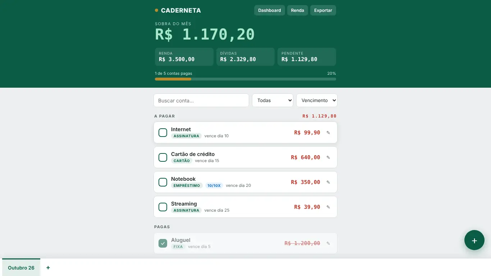

# Dividex

Caderneta de dívidas mensais para uso pessoal: a pessoa lança renda e contas de cada mês e vê quanto sobra e o que ainda falta pagar. O app se chama Caderneta na tela.

*Os valores do print são exemplos digitados por mim para a demonstração.*

## O que faz
- Organiza as contas por mês, em abas. Ao criar um mês novo, dá para copiar as contas recorrentes do mês atual.
- Mostra a renda, o total de dívidas, o valor pendente e a "sobra do mês", com uma barra de progresso das contas pagas.
- Cadastra cada conta com nome, valor, dia de vencimento e categoria (Fixa, Assinatura, Cartão, Empréstimo, Pessoa ou Outro).
- Aceita contas recorrentes e contas com prazo em meses, que aparecem com o contador de parcelas.
- Permite buscar por nome, filtrar por categoria e ordenar por vencimento, maior valor ou nome.
- Tem um dashboard com totais gerais, meses futuros, parcelamentos e as categorias que mais pesam, e exporta um backup em JSON.

## Como fiz
- Um único `index.html`, sem framework, sem build e sem backend.
- Os dados ficam no próprio aparelho, em IndexedDB, com espelho em `localStorage` como segunda opção. Se nenhum dos dois estiver disponível, o app avisa que está só em memória.
- A gravação espera 300 ms depois da última alteração e é forçada quando a página fica oculta ou é fechada (`visibilitychange` e `pagehide`), para não perder dados no celular.
- A tela é uma coluna única, com abas de mês no rodapé e botão flutuante para adicionar conta.
- Os valores são formatados com `toLocaleString` em `pt-BR` e BRL.

## Tecnologias
`HTML` `CSS` `JavaScript` `IndexedDB`

## Como rodar
Baixe o `index.html` e abra no navegador. Os dados ficam salvos nesse navegador.

## Acesse
https://ricardovsantos.github.io/Dividex/

## Autor
Ricardo Vieira dos Santos · [Portfólio](https://portifolio.ricardosantosdev.tech) · [LinkedIn](https://www.linkedin.com/in/ricardo-santos-0ba84b384)
